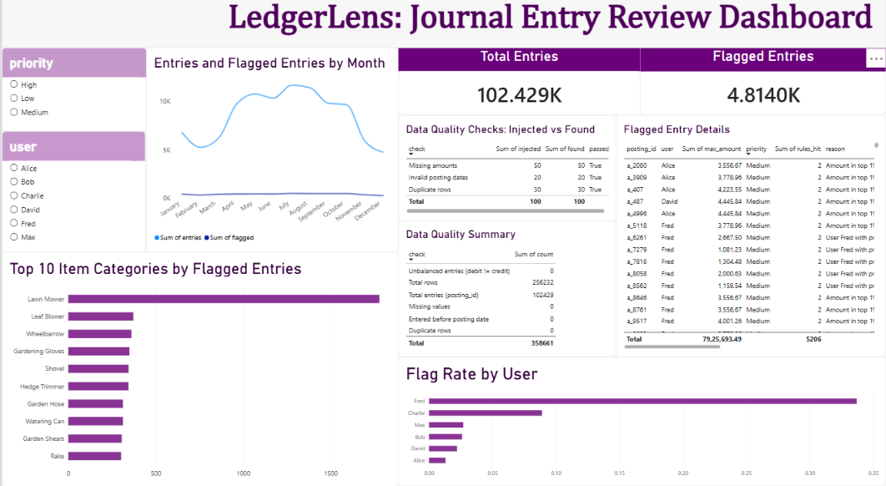

# LedgerLens: Journal Entry Data Quality and Anomaly Review

A rule-based system that checks a general ledger for data-quality problems, flags unusual journal entries, explains why each entry was flagged, and ranks entries so an analyst knows what to review first. It does not declare anything fraudulent: it prepares a review list for a human.

Built with Python (pandas), SQL Server and Power BI.



## Dataset

Synthetic general ledger data for a fictional company, from Gronewald, Stephan, Rombach and Fettke, *Generating synthetic journal entries for audit analytics: Method and dataset* (Data in Brief, 2026). Dataset DOI: 10.5281/zenodo.22014653.

- 256,232 rows (posting lines), 102,429 journal entries, postings from 2023-01-02 to 2024-12-30
- `label` marks artificially inserted anomalies; `marking` gives one of 8 anomaly types
- Column meanings: see [docs/data_dictionary.md](docs/data_dictionary.md)

The data is synthetic. Results here do not show how the rules would perform on a real ledger.

## What the project does

1. **Data-quality checks:** missing values, duplicate rows, entries posted before their posting date, entries where debits do not equal credits.
2. **Proof that the checks work:** the original data was already clean, so a corrupted copy was created with 50 missing amounts, 30 duplicate rows and 20 invalid dates. The checks found exactly 50, 30 and 20.
3. **Rule-based anomaly flags:**

| Rule | Logic |
|---|---|
| Late entry | Entered more than 30 days after the posting date |
| Large amount | Amount in the top 1% of all lines |
| Non-working hours | `nwh` = 1 |
| Fred, weekend | User Fred with `weekend` > 0 |
| Fred, delayed | User Fred with `promptly` = 2 |

4. **Explanations:** every flagged entry carries the text of each rule that flagged it.
5. **Priority:** entries flagged by more rules are ranked higher (High = 3 rules, Medium = 2, Low = 1).
6. **Dashboard:** Power BI report built from the CSV files in `outputs/`.

## Results (entry level, checked against the labels)

| Metric | Value |
|---|---|
| Total entries | 102,429 |
| Flagged entries | 4,814 (4.7%) |
| Anomalous entries caught | 721 of 850 |
| False alarms | 4,093 |
| Precision | 0.150 |
| Recall | 0.848 |
| F1 | 0.255 |

Precision by priority: High 0.429 (14 entries), Medium 0.225 (364), Low 0.143 (4,436). Entries flagged by more rules are more likely to be real anomalies.

Recall by anomaly type: types 3, 5, 6 = 1.00; type 4 = 0.97; type 1 = 0.79; type 2 = 0.62; type 7 = 0.05; type 8 = 0.00.
## SQL analysis

The same ledger was loaded into SQL Server and queried with T-SQL (see sql/queries.sql):

| Query | Result |
|---|---|
| Unbalanced entries (GROUP BY / HAVING) | 0 |
| Entries per month (COUNT DISTINCT) | 24 months, 102,429 entries |
| Flagged entries per user (JOIN) | Fred has the most (2,340 of 6,951) |
| Precision by priority (CASE / CAST) | High 0.429, Medium 0.225, Low 0.143 |
| Top entries to review (TOP / ORDER BY) | 10 highest-priority entries |
## Limitations

- **Optimistic results.** The Fred rules and the thresholds were chosen after looking at the labelled data, then evaluated on the same data. Real performance would be lower.
- **Synthetic data.** Anomalies were injected by a generator, so they are cleaner than real-world problems.
- **Low precision.** About 85 of every 100 flagged entries are false alarms.
- **Two types are missed.** Type 7 (shadow bank account) and type 8 (cross-linked clearing) are not covered by the current rules.
- **User-specific rules** only make sense for this dataset. They would not carry over to another company.
- The exact meaning of `weekend` values 1 and 2 is not given in the dataset paper; the rules only use "greater than 0".

## Possible improvements

- Add a rule for postings to rarely used accounts (targets type 7).
- Check the `ref_id` clearing links (targets type 8).
- Test an unsupervised model such as Isolation Forest and compare it with the rules, without using labels to pick rules.
- Weight entries by business impact (amount) when ranking the review list.

## How to run

1. Put `journal_entries_4203.csv` in `data/raw/`.
2. Install: `pip install pandas`
3. Run `Loanlens_final.py` from the project folder. It writes the CSV files to `outputs/`.
4. Open `dashboard/LedgerLens_dashboard.pbix` in Power BI Desktop. If the data does not load, point the data sources to your `outputs/` folder.

## Project structure

```
data/raw/          original dataset (not edited)
data/processed/    corrupted copy used to test the checks
outputs/           CSV files produced by the script
sql/               T-SQL queries
dashboard/         Power BI file and screenshot
docs/              data dictionary
Loanlens_final.py  full pipeline
```
